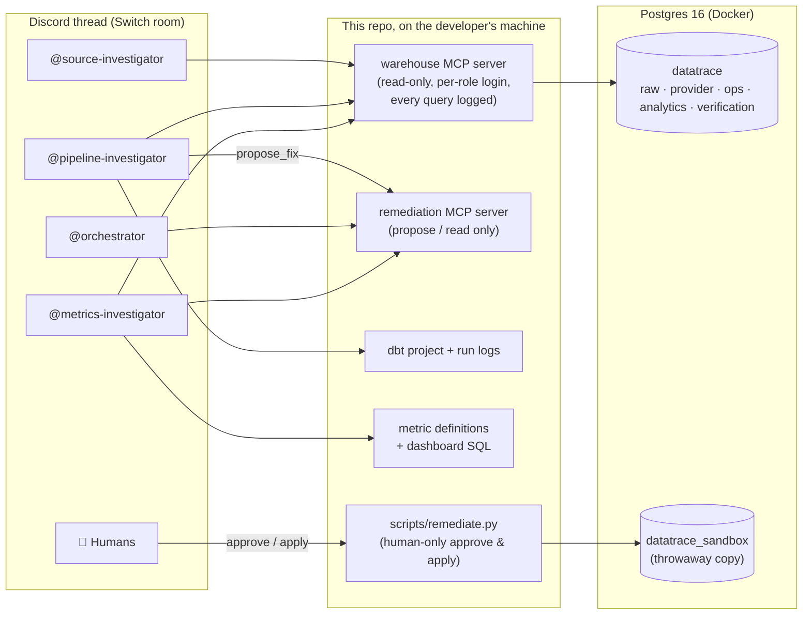
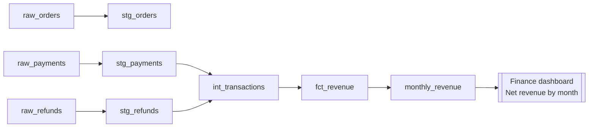
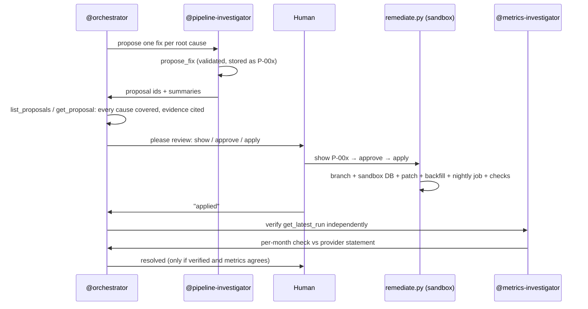

# DATA TRACE

> **When your data doesn't add up, find out why.**

DATA TRACE is a team of four AI agents that sits in your team chat and investigates data
discrepancies the way a good data team does: each specialist looks at the part of the stack it is
allowed to see, every claim comes with a query or a file reference, and nothing is fixed until a
human approves it.

Built on [Switch](https://docs.switchagents.ai/) and Claude Code for the
**Flip the Switch Hackathon** (WeMakeDevs × DevTools Academy, 4–7 Nov 2026) — Track 01, *Best Business Workflow*.

| | |
|---|---|
| **Problem** | Finance's dashboard says October net revenue was **₹41,49,255**. The payment provider's statement says **₹46,25,583**. Nobody knows where **₹4,76,328** went. |
| **What DATA TRACE does** | A person reports the gap in a Discord thread. Four agents split the investigation by access, report findings with evidence, reconcile the gap to **₹0 unexplained**, and propose fixes. A human approves; fixes are applied and verified in an isolated sandbox. |
| **Result (rehearsal run 1)** | All 4 root causes found with correct mechanisms, gap fully reconciled, time-zone hypothesis ruled out with evidence. See [`docs/runs/run-01-report.md`](docs/runs/run-01-report.md). |
| **Demo video** | _TODO: add link_ |

---

## Table of contents

1. [Why this exists](#1-why-this-exists)
2. [How Switch is used (and why it is essential)](#2-how-switch-is-used-and-why-it-is-essential)
3. [The agents](#3-the-agents)
4. [Architecture](#4-architecture)
5. [The demo scenario](#5-the-demo-scenario)
6. [Setup from scratch](#6-setup-from-scratch)
7. [Running an investigation](#7-running-an-investigation)
8. [Remediation: propose → approve → sandbox → verify](#8-remediation-propose--approve--sandbox--verify)
9. [Safety and guardrails](#9-safety-and-guardrails)
10. [Results](#10-results)
11. [Repository layout](#11-repository-layout)
12. [Scripts reference](#12-scripts-reference)
13. [Troubleshooting](#13-troubleshooting)
14. [Limitations and what's next](#14-limitations-and-whats-next)
15. [Hackathon submission checklist](#15-hackathon-submission-checklist)

---

## 1. Why this exists

"The dashboard doesn't match finance's numbers" is one of the most common, most expensive
tickets a data team gets. Finding the cause usually means several people with different
knowledge — the person who owns ingestion, the person who owns the dbt models, the person who
knows what the metric is supposed to mean — comparing notes in a chat thread for days.

Real discrepancies are rarely one bug. In this demo the gap is the sum of **four independent
problems** in three different layers (ingestion, transformation, scheduling), plus a decoy
anomaly that looks like a bug but isn't. A single all-seeing agent tends to stop at the first
plausible cause. DATA TRACE reproduces how a real team works instead:

- **Specialists with limited access.** Each agent sees only its layer, so they *must* talk to each
  other to solve the case — exactly like a real team.
- **Evidence or it didn't happen.** Every finding cites a `query_id` (logged with its SQL) or a
  `file:line`. The orchestrator refuses to accept a claim without one.
- **Reconcile to zero.** The investigation keeps a running ledger and can't close while any rupee
  is unexplained.
- **Humans decide.** Agents propose fixes; only a person can approve and apply them, and they run in
  a sandbox copy first.

## 2. How Switch is used (and why it is essential)

Switch turns a chat channel into a **room**: a shared space where people and agents read the same
messages, rules and context. Each agent joins under its own name and is addressed with `@name`.

DATA TRACE depends on Switch for everything that makes it a *team* rather than a script:

| Need | How Switch provides it |
|---|---|
| Four separate Claude Code agents, each with its own working directory, tools and permissions | Switch Console runs each agent as its own Claude Code session started in `agents/<name>/` |
| Agents talking to each other and to people | All four agents and the humans share one Discord thread (room) through Switch |
| Coordination | Agents hand work to each other with `@mentions` (`@source-investigator`, `@pipeline-investigator`, …) |
| Human authority | Humans in the room steer the investigation, challenge findings and approve fixes |
| One shared record | The thread holds every finding, the reconciliation ledger and the final report |

**Without Switch the project does not work:** no agent alone has enough access to find all four
causes (by design — see the access table below), and there is no other channel through which they
can share findings or receive human approval.

## 3. The agents

| Agent | Role | Can see | Cannot see |
|---|---|---|---|
| `@orchestrator` | Leads the investigation: restates the problem, assigns questions, keeps the ledger, demands evidence, writes the final report, runs the fix approval flow | Only what others post in the room (+ read-only view of fix proposals) | The warehouse, code, logs |
| `@source-investigator` | Did the data arrive intact? Reconciles raw tables against the provider, finds missing/duplicate rows, checks ingestion health | `raw`, `provider`, `ops`, `analytics` schemas | dbt code, dbt run logs, metric definitions |
| `@pipeline-investigator` | Does the transformation do what it claims? Reads every model, traces lineage, checks run history and test warnings, quantifies bugs, **proposes fixes** | dbt project, dbt run artifacts/logs, `raw`, `ops`, `analytics` | The provider's export and statement, metric definitions |
| `@metrics-investigator` | Is the metric defined and reported correctly? Recomputes it independently from the provider export, localises differences, assesses impact, **verifies fixes** | Metric definitions, dashboard SQL, `provider`, `analytics` | Raw tables, dbt code, logs |

Each agent's behaviour is defined in its brief, `agents/<name>/CLAUDE.md`. All four share the
same rules of engagement:

- Every claim cites evidence the agent produced itself (`query_id` + SQL, or `file:line`).
- Numbers are reported exactly as returned (INR, IST); never estimated.
- Observed facts are separated from inferences, with a confidence level.
- If something is outside an agent's access, it says so and `@mentions` the agent who can check.
- Lineage dependencies are *potential* impact; impact must be confirmed with data.
- Agents stay in one thread and always `@mention` who they are answering.
- Findings use a fixed format:

```
FINDING <short id>: <one-line claim>
Observed: <what the data/code shows>
Evidence: <query_id + SQL, or file:line>
Impact: <₹ amount and which month, if quantifiable>
Confidence: high | medium | low, because <reason>
Open question: <what would confirm or refute this, and who can check it>
```

## 4. Architecture



**Components**

- **Switch Console** (desktop app) runs the local Switch server, connects Discord, and starts each
  agent as a Claude Code session in its own `agents/<name>/` directory.
- **Warehouse** — Postgres 16 in Docker, bound to `127.0.0.1:55432` only.
- **Warehouse MCP server** (`tools/warehouse_mcp/server.py`) — gives each investigator three tools:
  `list_tables`, `describe_table`, `run_query`. Every call gets a `query_id` and is appended to
  `logs/agent_queries/<role>.jsonl`, so any number posted in chat can be traced back to its SQL.
- **dbt project** (`dbt_project/`) — the transformation pipeline under investigation.
- **Remediation MCP server** (`tools/remediation/mcp_server.py`) — lets the pipeline investigator
  *propose* fixes and every agent *read* proposals and sandbox results. It cannot approve or apply.
- **Remediation CLI** (`scripts/remediate.py`) — human-only: review, approve/reject, and apply
  approved fixes in a sandbox database on a separate git branch, then verify.

### Warehouse schemas and access

| Schema | Contents | agent_source | agent_pipeline | agent_metrics |
|---|---|---|---|---|
| `raw` | orders, payments, refunds, customers, products as ingested (append-only) | read | read | – |
| `provider` | payment provider's transaction export and monthly statement | read | – | read |
| `ops` | ingestion run logs, dead-letter queue | read | read | – |
| `analytics` | dbt models | read | read | read |
| `verification` | ground truth for scoring | – | – | – |

Other logins: `datatrace_admin` (setup only, never given to agents), `dbt_runner` (owns
`analytics`, runs dbt), `remediation_runner` (can connect **only** to `datatrace_sandbox`).

### Data pipeline (dbt)



| Model | Type | What it does |
|---|---|---|
| `stg_orders` | view | Orders with IST order date |
| `stg_payments` | view | Successful payments, deduplicated to one row per `payment_id` |
| `stg_refunds` | view | Processed refunds |
| `int_transactions` | view | Revenue ledger: payments (+) and refunds (−) at the time money moved |
| `fct_revenue` | table | Daily gross, refunds and net revenue by payment method (IST days) |
| `monthly_revenue` | table | Monthly totals; the only source of the finance dashboard. `built_at` = last rebuild time |

Production schedule (`dbt_project/jobs/schedule.yml`):

| Job | When | Command |
|---|---|---|
| `nightly` | 02:30 IST daily | `dbt build --select +fct_revenue` |
| `month_close` | 01:00 IST on the 1st | `dbt build` |

The finance metric definitions live in `metrics/definitions.yml`; the dashboard tile's query is
`metrics/dashboards/finance_revenue.sql`.

## 5. The demo scenario

A fictional Indian e-commerce company (INR, IST), with September and October 2026 data:
1,100 customers, 40 products, ~2,280 orders, ~2,600 raw payment rows, ~165 refunds, a 2,777-row
provider transaction export and the provider's monthly statement.

The data is generated deterministically by `database/seed/generate.py` (seed `20261104`, stdlib
Python only); the CSVs are committed so Python is not needed to load them. The generator plants
realistic problems and records the ground truth in the `verification` schema, which no agent can
read. That makes every investigation **scorable**.

> ⚠️ **Spoiler section.** The answers below are for judges and maintainers. Agents are blocked from
> reading this file, `docs/` and `database/` (see [Safety](#9-safety-and-guardrails)).

<details>
<summary><b>The four root causes and the decoy (click to expand)</b></summary>

| # | Problem | Layer | Mechanism |
|---|---|---|---|
| 1 | **Rejected ingestion batches** | Ingestion | On 22 Oct the provider sent `captured_at` as epoch-milliseconds. Two payments batches (`pay_20261022T0600`, `pay_20261022T1200`) rejected every row to `ops.ingestion_dead_letter`, yet the runs were marked `succeeded`. |
| 2 | **Valid status filtered out** | dbt staging | The provider added status `auto_captured` (UPI AutoPay) on 10 Oct. `stg_payments.sql` keeps only `status = 'captured'`. A dbt `accepted_values` test catches it — but at `severity: warn`, so every run "passes". |
| 3 | **Refund fan-out** | dbt intermediate | `int_transactions.sql` joins refunds to payments on `order_id` instead of `payment_id`. Orders split across two payments subtract the same refund twice. |
| 4 | **Stale monthly model** | Scheduling | `monthly_revenue` was built by `month_close` (1 Nov, 01:00) before the 31 Oct payments were backfilled after a provider outage. The `nightly` job only builds `+fct_revenue` (upstream), so `monthly_revenue` is never refreshed. |
| Decoy | **Duplicate raw rows** | Ingestion | Two batches on 9 Oct were delivered twice. Looks alarming, but `stg_payments` deduplicates by `payment_id`, so revenue is unaffected. A good investigation reports it as **ruled out**. |
| Decoy | **Time zones** | — | Month-boundary/time-zone error is the obvious first guess. `fct_revenue` converts to `Asia/Kolkata` correctly; it should be ruled out with evidence. |

**October reconciliation** (attributed without double counting, as in run 1):

| Cause | Impact |
|---|---|
| Rejected ingestion batches (27 successful payments) | ₹1,19,934 |
| `auto_captured` excluded (59 payments) | ₹2,08,748 |
| Stale `monthly_revenue` (late Oct 31 payments) | ₹1,14,376 |
| Refund fan-out (13 extra refund rows) | ₹33,270 |
| **Total = provider ₹46,25,583 − dashboard ₹41,49,255** | **₹4,76,328** |

The causes overlap (e.g. some dead-lettered and late payments are `auto_captured`), so the
*isolated* impact of each bug — stored in `verification.planted_issues` — is larger than its share
above. Both views are correct; the table above is the one that sums to the gap.

September also has a smaller gap (dashboard ₹33,08,525 vs provider ₹33,29,525) caused only by the
refund fan-out — a good test of whether agents check *other* months for potential impact.

</details>

## 6. Setup from scratch

Tested on macOS (Apple Silicon). Plan for ~20 minutes the first time.

### 6.1 Prerequisites (installed system-wide)

- **Docker Desktop**
- **Python 3.12** (`python3.12 --version`)
- **Git**
- **Claude Code CLI**, signed in: `claude auth login`
- **Switch Console** desktop app — see the [Switch docs](https://docs.switchagents.ai/) quickstart
- A **Discord** server you can add bots to (or Switch's bundled Mattermost)

### 6.2 Clone and configure secrets

```sh
git clone <this repo> DataTrace && cd DataTrace
cp .env.example .env
```

Edit `.env` and replace **every** `change-me` with a strong random value, for example:

```sh
for k in WAREHOUSE_ADMIN_PASSWORD AGENT_SOURCE_PASSWORD AGENT_PIPELINE_PASSWORD \
         AGENT_METRICS_PASSWORD DBT_RUNNER_PASSWORD REMEDIATION_RUNNER_PASSWORD; do
  sed -i '' "s|^$k=.*|$k=$(openssl rand -hex 16)|" .env
done
```

Don't wrap values in quotes. `.env` is gitignored.

### 6.3 Python environment

```sh
python3.12 -m venv .venv
.venv/bin/pip install -r requirements.txt     # dbt-core, dbt-postgres, mcp, psycopg
```

### 6.4 Start the warehouse and load data

```sh
./scripts/db-setup.sh     # starts Postgres, creates schemas + least-privilege logins, loads seed data
./scripts/db-check.sh     # proves each agent login can read only what it should
```

Every line of `db-check.sh` should match its `expect` note (`ok` or `denied`).

### 6.5 Recreate the production pipeline history

```sh
./scripts/pipeline-replay.sh
```

This replays what happened in "production", in order:

1. reloads the warehouse as it stood at month close;
2. runs the **month_close** job (`dbt build`) — builds everything, including `monthly_revenue`;
3. loads the **late data** (31 Oct payments backfill, later refunds, backfill run logs);
4. runs the **nightly** job (`dbt build --select +fct_revenue`).

Each job's `console.txt`, `dbt.log`, `run_results.json` and `manifest.json` are saved in
`pipeline_logs/<timestamp>_<job>/` for the pipeline investigator.

> Run `pipeline-replay.sh` once per fresh setup. Running it again adds another pair of job folders
> to `pipeline_logs/`; move old ones aside first so the agents see one clean history.

### 6.6 Verify the bugged state

```sh
./scripts/verify.sh
```

- Section 1: every row says **MATCH** (the pipeline reproduces the expected buggy numbers).
- Section 2: October shows dashboard `4149255` vs true `4625583`, status **OPEN**.

### 6.7 Check the MCP servers

```sh
.venv/bin/python tools/warehouse_mcp/smoke_test.py     # must end with: ALL PASS
```

### 6.8 Generate per-agent config

```sh
.venv/bin/python scripts/agents-setup.py
```

This writes, for each agent, `agents/<name>/.mcp.json` (its MCP servers and database role) and
`agents/<name>/.claude/settings.json` (allowed tools, readable directories, denied paths). These
contain absolute paths, so they are gitignored — **re-run after cloning or moving the folder.**

### 6.9 Register the agents in Switch

In Switch Console:

1. Start the local Switch server and connect Discord.
2. Create a channel/room for investigations, e.g. `#investigation`.
3. Add four **Claude Code** agents with exactly these names and directories:

   | Agent name | Directory |
   |---|---|
   | `orchestrator` | `<repo>/agents/orchestrator` |
   | `source-investigator` | `<repo>/agents/source-investigator` |
   | `pipeline-investigator` | `<repo>/agents/pipeline-investigator` |
   | `metrics-investigator` | `<repo>/agents/metrics-investigator` |

4. Add all four to the room. Claude Code picks up each agent's `CLAUDE.md`, `.mcp.json` and
   `.claude/settings.json` automatically because the session starts in that directory.
5. Check each agent is online and shows the `warehouse` / `remediation` MCP tools.

The names matter: the briefs tell agents to `@mention` each other by these exact names.

### 6.10 Restarting after a reboot

The data lives in the Docker volume `datatrace_warehouse_data`, so you don't need to reload it.

```sh
cd DataTrace
docker compose up -d --wait     # start Postgres (Docker Desktop must be running)
./scripts/verify.sh             # confirm the bugged state is still there
```

Then open Switch Console and check the agents are online. **Don't** run `db-setup.sh` here: it
reloads the month-close seed and leaves the analytics tables out of step with the raw data
(use `pipeline-replay.sh` if you need to reset everything).

## 7. Running an investigation

Post a message in the investigation room as a person, mentioning the orchestrator. For example:

```text
@orchestrator Finance flagged October 2026 revenue. The "Net revenue by month" dashboard
shows ₹4,149,255 but the payment provider's October statement says net collections were
₹4,625,583. That's ₹476,328 missing. Can you find out why, fully reconcile the gap, and
tell us what to fix?
```

What happens next:

1. **Orchestrator** restates the problem (metric, period, both figures, gap) and asks each
   specialist a specific question.
2. **Source investigator** compares raw payments with the provider export by day, status and batch
   and finds what never landed.
3. **Pipeline investigator** reads the models on the path to `monthly_revenue`, checks run history
   and test warnings, and quantifies each defect by running the model logic and a corrected version.
4. **Metrics investigator** checks the dashboard query against the metric definition, recomputes the
   metric from the provider export and localises the difference.
5. Agents **challenge and cross-check** each other's findings (e.g. a source anomaly may already be
   handled by the pipeline).
6. The orchestrator posts a **running ledger** — supported findings with ₹ impact, open hypotheses
   and who it's waiting on, unexplained remainder — until the remainder is ₹0.
7. It posts a **final report**: summary, root causes with evidence, ruled-out hypotheses, confirmed vs
   potential impact, and recommended fixes.

Everything stays in one thread. Humans can jump in at any point to redirect, ask questions or
push back.

**Auditing a claim:** any `query_id` in the thread (e.g. `q_aed4a7ad0e`) can be looked up in
`logs/agent_queries/<role>.jsonl` to see the exact SQL, who ran it, when, and how many rows it
returned.

## 8. Remediation: propose → approve → sandbox → verify

Agents can **propose** fixes. Only a person can approve and apply them, and they are applied to a
sandbox copy — never to production.



**Proposal kinds** (validated when proposed and again when applied):

| Kind | What it contains | Restrictions |
|---|---|---|
| `code_patch` | Complete new content of each changed file; the diff is computed automatically | Only `dbt_project/models/**`, `dbt_project/tests/**`, `dbt_project/jobs/schedule.yml`. Models must be pure SELECTs (no hooks, DDL/DML, `run_query`, `statement()`). Schedule commands must be plain `dbt build/run/test`. |
| `backfill_sql` | One `INSERT INTO raw.raw_payments|raw.raw_refunds ... SELECT ...` rebuilding rows from data already in the warehouse | Single statement, no other DML/DDL, runs only in the sandbox |

**Human commands** (from the repo root):

```sh
.venv/bin/python scripts/remediate.py list                 # all proposals and status
.venv/bin/python scripts/remediate.py show P-001           # rationale, evidence, exact diff / SQL
.venv/bin/python scripts/remediate.py approve P-001 P-002  # records your git user.name (or --by NAME)
.venv/bin/python scripts/remediate.py reject P-003 --note "why"
.venv/bin/python scripts/remediate.py apply                # applies every approved, not-yet-applied proposal
```

**What `apply` does:**

1. Creates git branch `remediation/R-<timestamp>` in a separate worktree
   (`remediation/runs/R-…/workspace`). Your working copy and `main` are untouched.
2. Rebuilds database `datatrace_sandbox` from a dump of production (`raw`, `provider`, `ops`,
   `analytics` — **not** `verification`), owned by `remediation_runner`.
3. Applies the code patches in the worktree and commits them on the branch. Refuses if a file
   changed since the proposal was made.
4. `dbt parse` to validate, then runs backfill SQL in the sandbox.
5. Redeploys only the models whose code changed, then runs the **nightly** command from the
   **patched** `schedule.yml` — exactly what would happen in production after a release.
6. Verifies: dbt reports no errors or failed tests, **and** `monthly_revenue.net_revenue` equals the
   provider's `net_collections` for every statement month.

The result is written to `remediation/runs/R-…/result.json` (`"verified": true|false`, per-month
comparison, dbt status counts, models built) and read by the agents with `get_latest_run`.
Proposals become `applied` only if verification passes. Every action is appended to
`remediation/audit.jsonl`.

## 9. Safety and guardrails

Defence in depth — no single layer is trusted on its own.

**Database**
- One Postgres login per agent, with grants only on the schemas it needs.
- Agent logins have `default_transaction_read_only = on` and a 30 s `statement_timeout`.
- The MCP server additionally opens read-only transactions, accepts exactly one
  `SELECT`/`WITH`/`EXPLAIN`/`VALUES`/`TABLE`/`SHOW` statement per call, and caps results at 500 rows.
- Ground truth (`verification`) is readable only by the admin login.
- The warehouse port is bound to `127.0.0.1` only.

**Files and tools** (`agents/<name>/.claude/settings.json`, generated by `scripts/agents-setup.py`)
- `Bash`, `Write`, `Edit`, `NotebookEdit`, `WebFetch`, `WebSearch` are denied for every agent.
- No agent can read `database/` (generator + answers), `docs/` (past run reports), `README.md`,
  `logs/`, `scripts/`, `tools/`, `.git/`, `.env`, or another agent's directory (where Switch keeps
  its API token).
- Only the pipeline investigator can read `dbt_project/` and `pipeline_logs/`; only the metrics
  investigator can read `metrics/`.

**Remediation**
- Agents can propose but not approve or apply; the MCP server has no such tools.
- Proposals are validated on submit **and** re-validated at apply time.
- Fixes run only in `datatrace_sandbox`, as `remediation_runner`, which has no connect privilege on
  production. Code changes land on a separate branch for normal review.

**Auditability**
- Every agent query → `logs/agent_queries/<role>.jsonl` (query_id, role, timestamp, SQL, outcome).
- Every proposal, approval, rejection and apply → `remediation/audit.jsonl`.

## 10. Results

### Rehearsal run 1 (4 Nov 2026)

Scored against the hidden answer key (full report: [`docs/runs/run-01-report.md`](docs/runs/run-01-report.md)):

| Check | Result |
|---|---|
| 4 root causes found, mechanisms correct | ✅ |
| Gap fully reconciled (₹4,76,328, ₹0 unexplained) | ✅ |
| Time-zone hypothesis ruled out with evidence | ✅ |
| Duplicate-row decoy reported as ruled out | ❌ checked but not reported → briefs updated |
| Confirmed vs potential impact separated | ✅ |
| Fixes require human approval | ✅ |
| Run stalled once (a specialist didn't @mention the orchestrator) | fixed in briefs after this run |

Lessons from run 1 were turned into explicit rules in the briefs: always reply in the thread,
always `@mention` who you're answering, and report anomalies that were ruled out, with evidence.

## 11. Repository layout

| Path | Purpose |
|---|---|
| `agents/<name>/CLAUDE.md` | Each agent's brief (role, tools, rules of engagement) |
| `agents/<name>/.mcp.json`, `.claude/settings.json` | Generated per-agent MCP + permission config (gitignored) |
| `tools/warehouse_mcp/` | Read-only warehouse MCP server and its smoke test |
| `tools/remediation/` | Proposal store/validation and the remediation MCP server |
| `scripts/` | Setup, checks, pipeline replay, verification, remediation CLI |
| `database/schema/` | Schemas, tables, roles and grants |
| `database/seed/` | Deterministic data generator, CSVs, load scripts (contains the answers) |
| `database/init/` | Runs once when the Docker volume is first created |
| `dbt_project/` | dbt models, tests, macros, `jobs/schedule.yml`, project-local `profiles.yml` |
| `metrics/` | Finance metric definitions and the dashboard query |
| `pipeline_logs/` | Replayed job history (gitignored, produced by `pipeline-replay.sh`) |
| `logs/agent_queries/` | Query audit logs (gitignored) |
| `remediation/` | Proposals, run workspaces, audit log (gitignored) |
| `docs/runs/` | Reports from rehearsal runs |
| `backend/`, `frontend/`, `lineage/` | Reserved for a future web UI; not used by the current workflow |
| `docker-compose.yml` | The Postgres warehouse |

## 12. Scripts reference

| Command | What it does |
|---|---|
| `./scripts/db-setup.sh` | Start Postgres; (re)create schemas, roles and grants; load the month-close seed data |
| `./scripts/db-check.sh` | Show each agent login can read what it should and nothing else |
| `./scripts/pipeline-replay.sh` | Reset data, run month_close, load late data, run nightly; save artifacts to `pipeline_logs/` |
| `./scripts/verify.sh` | Compare warehouse outputs with the ground truth (admin only) |
| `.venv/bin/python scripts/agents-setup.py` | Generate per-agent `.mcp.json` and `.claude/settings.json` |
| `.venv/bin/python tools/warehouse_mcp/smoke_test.py` | Start the MCP server for each role and test allowed/denied queries |
| `.venv/bin/python scripts/remediate.py …` | Human-only remediation CLI (see section 8) |
| `.venv/bin/python database/seed/generate.py` | Regenerate the seed CSVs (deterministic; not needed normally) |
| `docker compose down` / `down -v` | Stop the warehouse / stop and **wipe** all data |

Connect manually: `psql "postgresql://$WAREHOUSE_ADMIN_USER@127.0.0.1:55432/datatrace"`

## 13. Troubleshooting

| Symptom | Fix |
|---|---|
| `set in .env` error from Docker Compose | `.env` is missing or a variable is empty — copy `.env.example` and fill every value |
| Port 55432 in use | Change `WAREHOUSE_PORT` in `.env`, then `docker compose up -d` |
| Changed passwords in `.env` but logins fail | `docker compose exec -T warehouse sh /database/setup.sh --roles-only` |
| `verify.sh` shows `DIFF` in section 1 | Data and models are out of step — run `./scripts/pipeline-replay.sh` |
| `dbt not found` | Create the venv and install requirements (section 6.3) |
| Agent has no `warehouse` tools in Switch | Re-run `scripts/agents-setup.py`; check the agent's Directory is `agents/<name>`; restart the agent |
| Agent asks for permission / can't read a file | Expected for forbidden paths. For allowed ones, re-run `agents-setup.py` (paths are absolute) |
| Investigation stalls | A reply probably didn't `@mention` anyone — mention `@orchestrator` in the thread to nudge it |
| `remediate.py apply`: "changed since the proposal was made" | The target file was edited after proposing — ask the pipeline investigator to re-propose |
| `remediate.py apply` fails creating the worktree | A previous branch/worktree with that name exists — `git worktree prune` |

## 14. Limitations and what's next

- Approval currently happens in a terminal (`remediate.py`), not in the chat itself.
- The demo uses one synthetic, planted scenario; it's a controlled benchmark with an answer key,
  not production data.
- Tested on macOS with Docker Desktop and Discord.
- Next: approve fixes directly from the Switch room, record decisions in Switch's Decisions panel,
  more scenarios (schema drift, late-arriving dimensions, currency conversion), and a lineage view.

## 15. Hackathon submission checklist

**Event:** Flip the Switch (WeMakeDevs × DevTools Academy). Deadline **7 Nov 2026, 11:59 PM IST**.
**Track:** 01 — Best Business Workflow. Judged on *Use of Switch*, *Technical execution*,
*Creativity and impact*, *Presentation*.

- [ ] Repository public, `.env` **not** committed (`git ls-files | grep -x .env` prints nothing)
- [ ] This README up to date; demo video link added at the top
- [ ] Demo video recorded (see outline below) and uploaded
- [ ] Latest run report in `docs/runs/`
- [ ] Submission form filled (text below)
- [ ] Optional: blog post (Best Blog side track), `#HowISwitch` social post

**One-line description**

> DATA TRACE: four Claude Code agents in a Switch room that investigate why your dashboard doesn't
> match finance's numbers — each with only its own slice of access, every claim backed by a logged
> query, the gap reconciled to ₹0, and fixes applied only after a human approves them in a sandbox.

**Short description**

> When a revenue dashboard disagrees with the payment provider's statement, a real data team
> splits the work: someone checks ingestion, someone reads the dbt models, someone checks what the
> metric should mean. DATA TRACE does exactly that inside a Switch room. An orchestrator and three
> specialist agents — source, pipeline and metrics — each connect to the warehouse with their own
> least-privilege login, so no single agent can solve the case alone; they have to share findings
> in the thread. Every number they post carries a query_id logged with its SQL. The orchestrator
> keeps a ledger until the ₹4,76,328 gap is fully explained (four independent bugs across ingestion,
> transformation and scheduling, plus decoys ruled out), then the pipeline agent proposes fixes.
> A human approves them, they're applied on a separate branch against a sandbox copy of the
> warehouse, and the metrics agent independently verifies the dashboard now matches the provider.

**How Switch is used** — see [section 2](#2-how-switch-is-used-and-why-it-is-essential).

**Demo video outline (3–4 min)**

1. *0:00* The problem: dashboard ₹41,49,255 vs provider ₹46,25,583 (show both).
2. *0:20* The team: four agents in Switch Console, the access table, why none can solve it alone.
3. *0:45* A person posts the problem in the Discord thread.
4. *1:00* Speed-up through the investigation: findings with query_ids, agents @mentioning each
   other, a cross-check, the ledger shrinking to ₹0.
5. *2:15* Final report: four causes, ruled-out hypotheses, confirmed vs potential impact.
6. *2:45* Fixes: proposals in chat, `remediate.py show` diff, human approves and applies,
   `VERIFIED`, metrics agent confirms.
7. *3:30* Guardrails in one slide (read-only logins, audit log, sandbox) and close.
